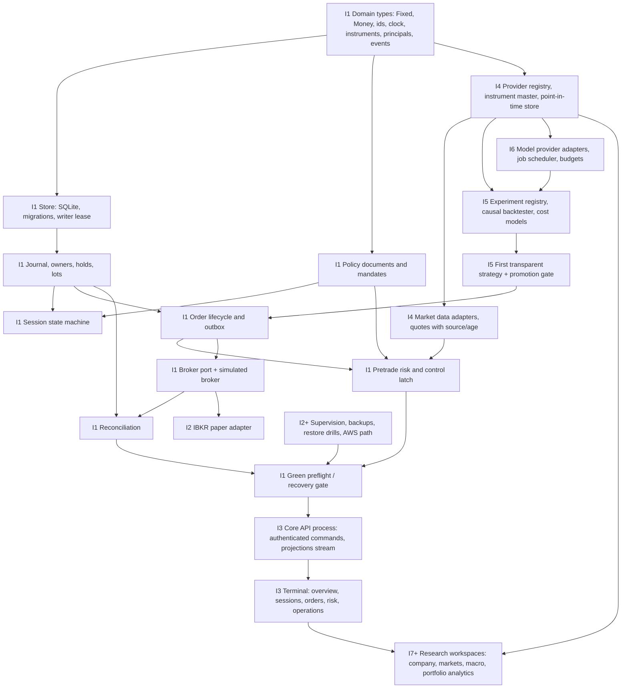

# Prioritized dependency graph

The order of work follows dependencies, not screens. A layer is started only when its inputs exist with tests. Increment numbers match `docs/status/STATUS.md`.

## Critical path to the integrated paper desk (book Chapter 27 completion definition)

1. **I1 — Foundation, offline.** Domain types, durable event-sourced store, journal with owner dimension, policy and mandate snapshots, session state machine, order lifecycle with outbox and unknown outcomes, pretrade risk, stop/start/recovery, typed broker port, deterministic simulated broker with fault injection, reconciliation. Exit: conservation, idempotency, replay-equivalence, cancel-race, restart, stop-persistence, successor and fault-matrix tests green.
2. **I2 — IBKR paper adapter.** Built from official TWS API documentation, with recorded-fixture tests. Exit: `paper-verified` evidence against an explicitly identified paper account. **Externally blocked** until the owner provides paper credentials and installs TWS or IB Gateway.
3. **I3 — Core API and terminal.** Authenticated command path and a projection stream. Workspaces: overview, sessions, orders and blotter, risk, operations, audit. Exit: every enabled control backed by a core command, plus browser tests.
4. **I4 — Data platform.** Provider registry, instrument master with provider mappings, point-in-time store, first lawful sources (SEC EDGAR, FRED/ALFRED, OpenFIGI, exchange calendars, IBKR market data where entitled).
5. **I5 — Research.** Experiment registry, causal event simulator sharing the core's order semantics, cost models, walk-forward evaluation, a first transparent strategy (`TREND_DAILY_V1`, book Chapter 15) and a promotion gate.
6. **I6 — Bounded agents.** Provider adapters (OpenAI, xAI, others) discovered at runtime, job contracts, budgets, routing evaluation and injection tests. Paid calls stay disabled until the owner configures a budget.
7. **I7 and later — Breadth.** Research workspaces toward the capability register: company research, filings and fundamentals, news, macro, portfolio analytics, then multi-asset analytics as research-only tracks.

Parallel tracks that never block the critical path: the capability register and its evidence; legal and eligibility records; the operations runbooks; the HFT research track (separate).
